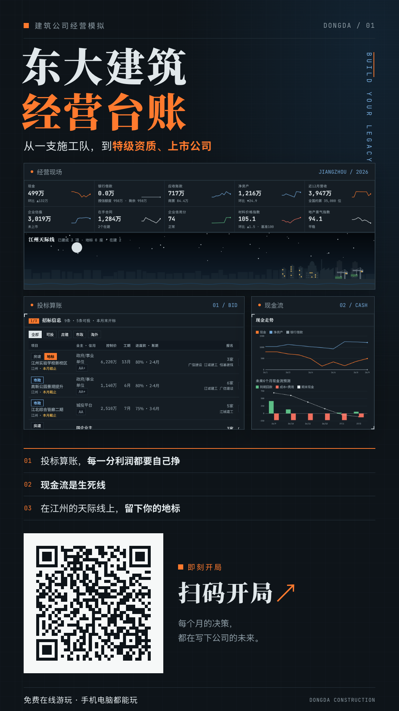
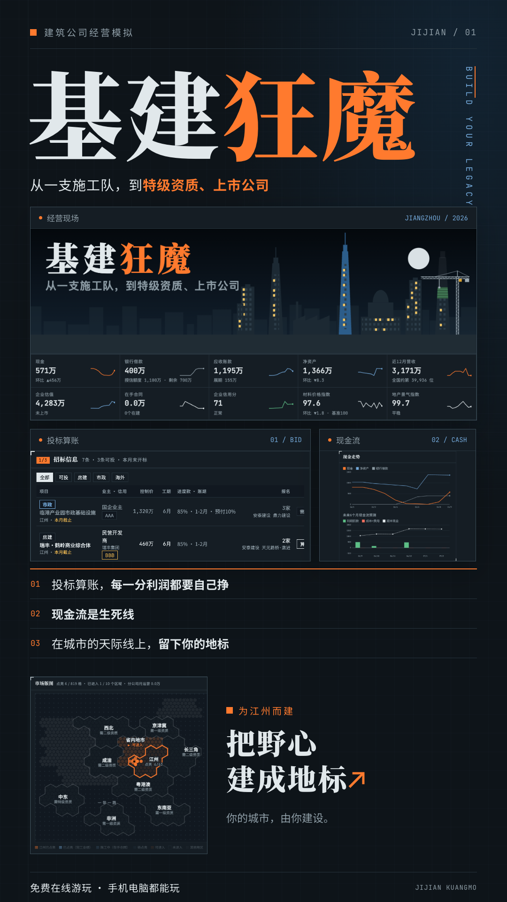

# 基建狂魔

**从一支施工队，到特级资质、上市公司。**

《基建狂魔》让你从一支施工队起步，经营一家属于自己的建筑公司。面对招投标、工程垫资和漫长账期，每个月的选择都影响公司的下一步。积累业绩、培养项目经理、升级资质，争取在城市的天际线上留下自己的地标。也可以切换时代剧本，在不同的市场周期里尝试新的经营路线，向特级资质和上市公司进发。

**[点击在线游玩](https://lynch715.github.io/jijian-kuangmo/)** · 免费 · 手机、电脑均可游玩

## 玩法要点

- **招投标**：研究业主信用、工程成本与竞争报价，选好项目经理再递交标书。
- **现金流**：跟踪回款、应收账款和银行授信，结合未来六个月预测安排投入。
- **资质升级**：通过完工项目积累业绩，满足净资产等条件，拓展房建、市政业务。
- **地标工程**：提前准备城市重大项目，在城市的天际线上留下自己的作品。
- **上市经营**：发展产业链布局，提升营收和企业估值，向上市公司迈进。
- **时代剧本**：可选择 2026 当下、2008 四万亿、2016 PPP 浪潮、2021 地产寒冬，并选择出身背景和难度。

## 界面外观

在「存档 → 界面外观」中，可选 **跟随系统、浅色、深色**。默认跟随系统，手动选择会记在当前浏览器中，刷新或下次打开后继续沿用。主题偏好独立于游戏进度，切换主题不会改动存档。

## 存档说明

进度存在**当前设备、当前浏览器**的 localStorage 中，操作后自动保存，另有三个手动存档位。刷新或关闭页面后，可在同一浏览器继续；清理网站数据或使用隐私模式可能导致存档丢失。

此次更名保留了原有存档键；新网址与原站同属一个站点，同一浏览器可继续读取本地进度。换设备、换浏览器或迁移网站时，请先在「存档 → 备份与迁移」里复制当前存档码，在目标浏览器粘贴读取。存档不会自动跨设备同步，不同浏览器（包括微信内置浏览器与系统浏览器）之间需要用存档码迁移。

## 宣传海报

两款均提供 **1080×1920 PNG** 和 **2160×3840 高清 PNG**。二维码直达在线游玩页面；封面版使用同一版式，以真实市场版图替换二维码。画面包含新版真实开局横幅，以及实际试玩八个月后的经营页、天际线、招标表、现金流和版图，未生成或伪造游戏画面。

| 扫码版 A | 封面版 B |
| --- | --- |
| [标准 PNG](posters/poster-qr.png) · [高清 PNG](posters/poster-qr-hd.png) | [标准 PNG](posters/poster.png) · [高清 PNG](posters/poster-hd.png) |
|  |  |

## 页面与海报源文件

游戏是原生单文件页面，**无需安装依赖、无需构建**。`dongda-mvp.html` 为原始文件；`index.html` 只补齐标准页面外壳、favicon 与分享信息，原有正文、CSS、JS 逐字保留。游戏字体沿用 Google Fonts。

- `posters/poster-qr.html`：扫码版源文件。
- `posters/poster.html`：封面版源文件。
- `posters/poster.css`：共用版式，使用游戏深色主题的 CSS 配色。
- `posters/assets/`：真实游戏截图、二维码及指定字体子集；字体许可见 `posters/assets/fonts/*-OFL.txt`。

本地预览（在仓库根目录执行，随后打开 <http://127.0.0.1:18765/>）：

```sh
python3 -m http.server 18765 --bind 127.0.0.1
```

修改海报文字后，安装仅用于出图的开发工具，再使用 Playwright 重出四张 PNG（默认使用已安装的 Google Chrome）：

```sh
npm install
npm run posters
```

更换二维码或海报文字后，可安装 Python 的 `qrcode[pil]`，执行 `python3 scripts/poster-assets.py --fonts` 更新二维码和字体子集，再重新出图。

`npm run capture` 会在独立浏览器会话中新开局、实际投标并推进八个月，更新 `posters/assets/` 中的游戏截图；不会接触日常浏览器的存档。更换本地服务端口可设置 `GAME_URL` / `POSTER_BASE`。更新页面外壳可运行 `python3 scripts/prepare-site.py`，脚本会检查原始样式、脚本与正文是否一致。

## 数值平衡回归

`node scripts/balance-sim/run.cjs [每组局数] [月数]` 会直接读取 `dongda-mvp.html` 的游戏逻辑，用三种自动玩家（不看现金猛投、参考现金预测谨慎投、按「若中标」提示投）在各开局、难度、时代下各跑若干局，输出破产率、升到一级资质的比例和幸存者净资产。调整数值后跑一遍，对比改动前后即可。

## 发布方式

GitHub Pages 从 **main 分支根目录**发布。分享预览 `og:image` 指向无二维码的 `posters/poster.png`，favicon 为橙色塔吊与建筑剪影。微信等平台的预览呈现和裁切以平台规则为准。

本次更名发布已完成应用内浏览器及 Playwright 验收：[检查记录与桌面、手机截图](docs/验收记录.md)。安装出图开发工具后，可执行 `node scripts/check-live.cjs` 复查线上开局、存档、布局、控制台及分享资源。
