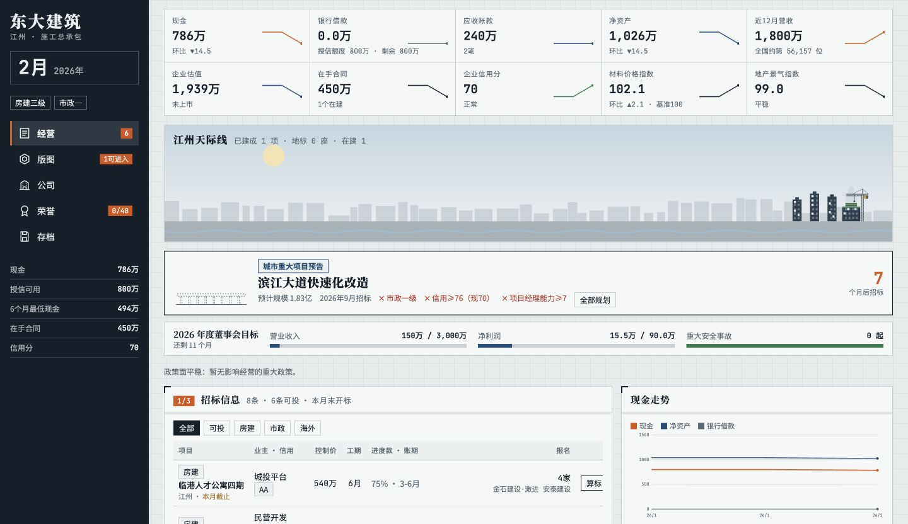
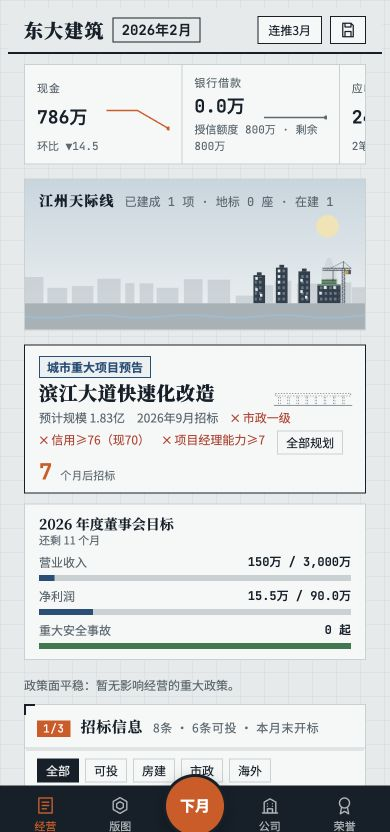
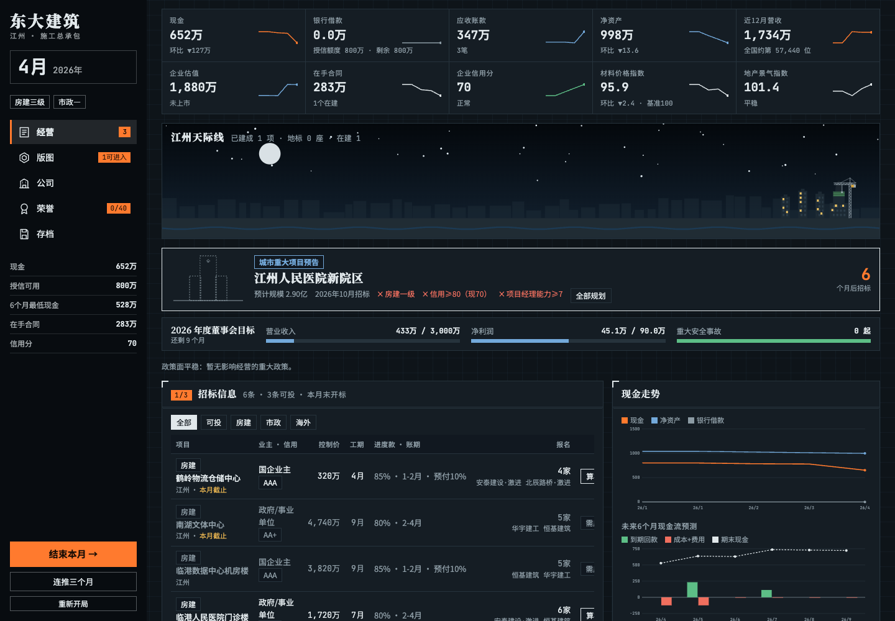
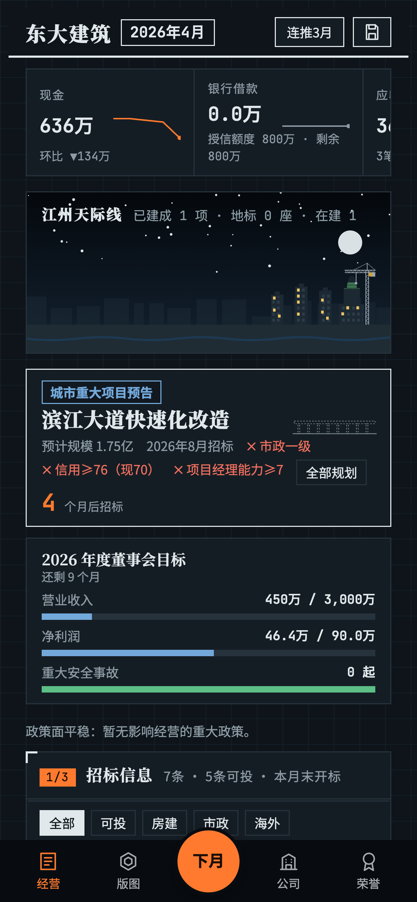

# 东大建筑经营台账 · 首次发布验收

验收日期：2026-11-06（America/Los_Angeles）。

- 仓库：https://github.com/Lynch715/dongda-construction-sim
- 在线：https://lynch715.github.io/dongda-construction-sim/
- 游戏与海报发布提交：`fad1d08`（发布东大建筑经营台账与宣传海报）。
- Pages 配置：`main` 分支、根目录 `/`。
- [首次 Pages 构建与部署成功记录](https://github.com/Lynch715/dongda-construction-sim/actions/runs/42185269961)。

## 页面与存档

`index.html` 的原始 `<style>`、`<script>` 和正文与 `dongda-mvp.html` 逐字相等；只增加标准文档外壳、字符集、视口、主题色、描述、Open Graph 与 SVG favicon。可选的 `window.claude` 调用、游戏逻辑、文案与存档键均保留。

1. Codex 应用内浏览器优先完成本地与线上检查：新开局、结束本月、结算、刷新续玩；线上 2026 年 2 月及关键指标在刷新前后保持一致。
2. 应用内浏览器桌面视口为 1440×1000，手机竖屏视口为 390×844，页面 `scrollWidth` 分别等于 1440、390，控制台无 error / warning。
3. Playwright 使用两个独立、无既有存档的浏览器会话检查线上桌面与手机：均新开一局，推进三个月至 2026 年 4 月，弹窗按第一个选项处理。
4. 两个会话刷新前后的 `dongda-mvp-v1` 完整存档字符串相同。未读取或改写日常浏览器的玩家存档。
5. 经营、版图、公司、荣誉、存档五个页面均无整页横向溢出。手机指标卡片区保留游戏原有的横向滑动设计。
6. 线上首页、分享图与 favicon 均返回 HTTP 200；无 JavaScript 异常、console error、失败请求或 HTTP 4xx / 5xx。
7. 已确认 `<!doctype html>`、`lang="zh-CN"`、viewport、原有标题、OG 图片地址与 favicon。

完整数据：[线上检查 JSON](live-check.json)。

## 浏览器截图

应用内浏览器的线上实截：

| 桌面（1440 宽） | 手机（390 宽） |
| --- | --- |
|  |  |

Playwright 的线上截图（手机为 3 倍像素密度，1170×2532 PNG）：

| 桌面 | 手机竖屏 |
| --- | --- |
|  |  |

## 海报与二维码

- 海报主体是独立新开局后真实投标、推进八个月得到的游戏截图；使用游戏自己的深色蓝灰与橙色变量，未伪造数据。
- 两份 HTML/CSS 源文件与共用样式均在 `posters/`；以 Playwright 的 1 倍、2 倍像素密度渲染，分别为 1080×1920、2160×3840。
- 四张图的实际尺寸、图片加载、所用字体加载、文本溢出和控制台检查均通过，见 [海报渲染 JSON](poster-render-check.json)。
- 海报 A 的二维码总边长为 378px，保留四模块浅色静区，Q 级纠错；使用 ZXing C++ 从最终标准图、高清图以及 768px、512px 宽缩图识别，均得到：`https://Lynch715.github.io/dongda-construction-sim/`。
- 海报 B 的标准图和高清图均未识别出二维码，二维码位置已换为真实市场版图。
- 识别记录：[二维码检查 JSON](qr-check.json)。

验收范围为应用内浏览器与 Chrome / Playwright 手机尺寸模拟；未使用实体 iPhone 或 Safari，也未做实体手机扫码与微信分享卡片的实机检查。
